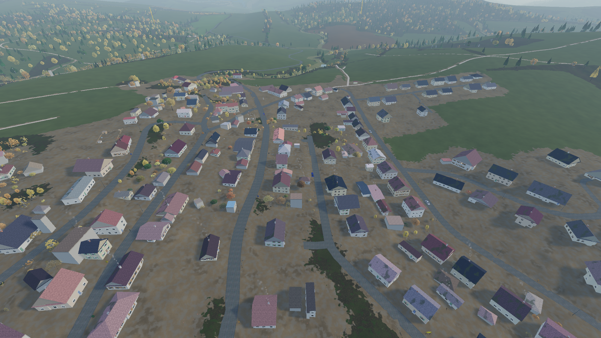
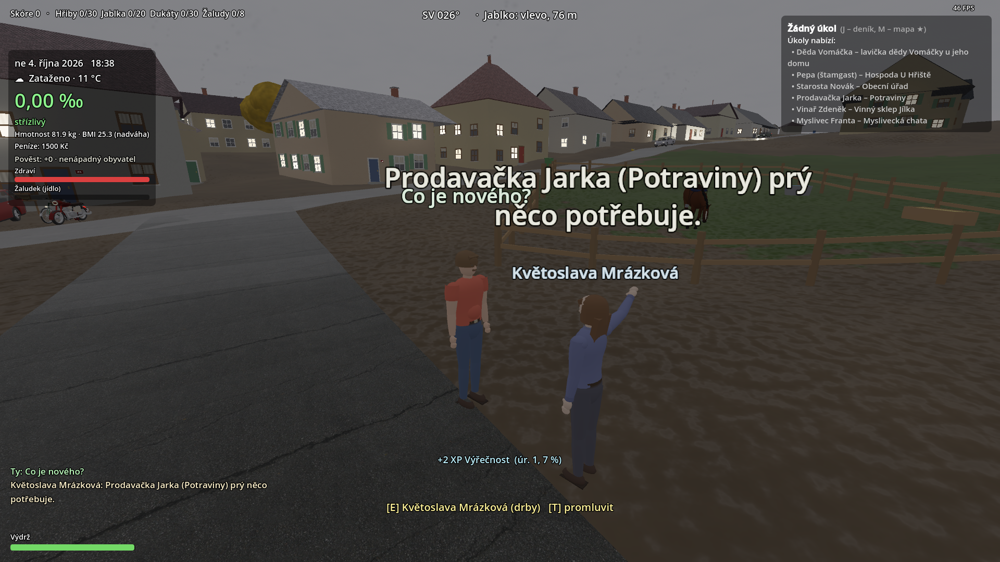
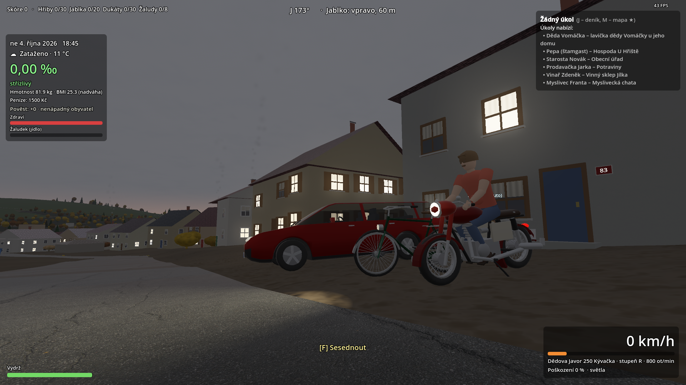
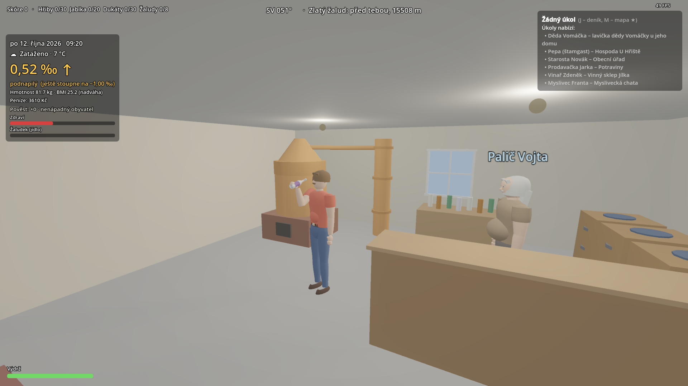
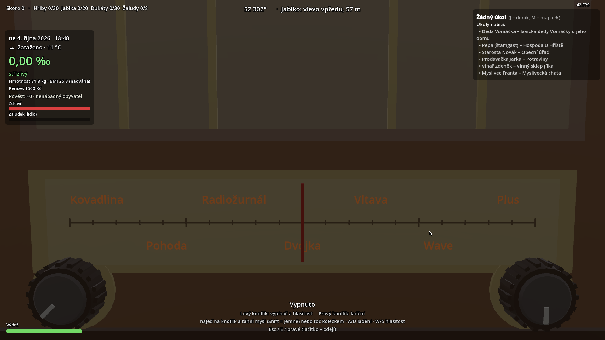

# Stone & Clay – herní verze mapy (MVP)

Open-world MVP v **Godot 4.3** nad detailní mapou ~11,3 × 7,5 km – katastr obce Dukelčic
plus katastry pěti okolních obcí (`blend/mapa_okoli.blend` + rozšíření v Pythonu – terén
DMR 5G, budovy s výškami z DMP 1G, silnice z OSM, ~51 700 stromů; barva terénu je
procedurální, ortofoto ČÚZK jen na přepnutí).

> *„Tato hra je satirickým uměleckým dílem. Všechny postavy, události a vyobrazené soukromé objekty
> jsou smyšlené. Jakákoliv podobnost se skutečnými osobami či konkrétními obydlími je čistě náhodná.“*

*Veřejný snapshot — vývoj probíhá v privátním repozitáři, historie commitů je zde squashnutá.*

## Screenshoty

| Letecký pohled na Dukelčice (dron) | Dialog s NPC na návsi |
|---|---|
|  |  |

| Motorka Javor 250 Kývačka za soumraku | Interiér pálenice |
|---|---|
|  |  |

| Rádio se stanicemi |
|---|
|  |

## Spuštění

```bash
./run.sh            # nebo: godot --path stone-and-clay
```

První spuštění naimportuje textury (~30 s). Načtení světa trvá ~2 s.

## O hře

**Dukelčice** je open-world simulátor života na české vesnici na věrné 3D mapě skutečného
katastru. Hráč se volně pohybuje pěšky, autem, na koni i ve vzduchu (dron, letadlo, paramotor,
motorové rogalo), plní drobné vesnické úkoly a nese si jejich následky – alkohol v krvi, policejní
kontroly, poškozené auto. Pod jednoduchým, laskavě humorným povrchem běží uvěřitelná simulace:
fyziologie, počasí a roční doby, doprava a policie, ekonomika, práce, zvěř a lov, hospodářství,
zahrada a desítky dalších systémů.

Kolem katastru leží pět okolních obcí s fiktivními názvy (Břehatice, Bohulečice, Březouchy,
Velký Oříškov, Hřiváčův Újezd) – jsou součástí detailní mapy: skutečná zástavba s kolizemi,
průjezdné silnice a zóna „v obci“ (limit 50 km/h), ale zatím bez vlastního herního obsahu
(úkoly, práce a příběh zůstávají v Dukelčicích); hráč vždy startuje v Dukelčicích.

Vize, pilíře a herní smyčka: [`GAME_DESIGN.md`](GAME_DESIGN.md).
Úplný technický rozpis všech implementovaných systémů: [`docs/SYSTEMS.md`](docs/SYSTEMS.md).

## Ovládání

| klávesa | pěšky | v autě |
|---|---|---|
| WASD / šipky | chůze | W plyn, S brzda / couvání, A/D řízení |
| myš | rozhlížení (klikni do okna) | rozhlížení kamerou |
| Shift | sprint (výdrž) | – |
| Mezerník | skok (delší stisk = výš) | ruční brzda |
| Ctrl / C | přikrčení, ve sprintu skluz | – |
| V | 1. ↔ 3. osoba | kamera za autem ↔ z interiéru |
| kolečko myši | vzdálenost kamery | – |
| E | interakce (místa, dveře, NPC, nocleh…) | – |
| T / Enter | říct něco nahlas (nejbližší/oslovená postava odpoví) | také |
| F5 / F9 | rychlé uložení / načtení pozice | také |
| F | nastoupit do auta / na kolo, motorku, koně | vystoupit / sesednout |
| L / B / N / R | – | světla / klakson / stěrače / postavit vozidlo |
| G | zvednout/naložit náklad, nebo hvízdnout na koně | – |
| X (držet) | dalekohled | – |
| Q, 1–5 | vybrat / přepnout nástroj v ruce | – |
| P | panel dokladů (řidičák, skupiny, body, zákaz) | – |
| LMB | kontextová akce (sběr, rybaření, střelba…) | – |
| RMB (držet) | míření se zbraní v ruce | – |
| Tab / I / J / K / M / H | inventář / oblečení / deník úkolů / dovednosti / mapa / domů | |
| M (mapa) | kolečko = zoom ke kurzoru, tažení = posun; mapa se překresluje jen při změně pohledu (marker hráče ~4× za s) | zavřít: M / Esc |
| U | vysvobození ze zaseknutí | – |
| F1 / Esc / F2 | nápověda / pauza a nastavení (mj. přepínač „Třes obrazu“ – abstinence a zima, ukládá se do `nastaveni.cfg`) / herní menu (čas, počasí, teleport…) | |
| F3 | menu pro vývojáře – ladění parametrů (jen se zapnutým **Režimem vývojáře**, Esc → Nastavení → Vývoj) | také (hra běží dál) |

Místa mají otevírací doby (`Place.HOURS` / `WEEK_HOURS`, výpis `hours_text()` ukazuje i víkend). Zavřené místo
od dveří nenabízí práci, úkoly ani zboží (`World.buy` to hlídá taky) a obsluha stojí venku jen v otevírací době.
Obecní úřad má úřední dny (Po a St 7–17, Út a Čt 8–14, Pá 8–12, víkend a svátky zavřeno). F2 → Teleport
má sekci „Okolní obce“ (postaví tě na okraj katastru čelem k obci; obce jsou jen pohled z dálky).

Funguje i herní ovladač. Ovládání koně, dronu, letadla, paramotoru a motorového rogala
(startovní procedury, přistání, licence) je v [`docs/CONTROLS.md`](docs/CONTROLS.md).

## Realismus (M8, probíhá)

Milník **M8 Realistický svět** mění krajinu a vesnici z „kulis“ na propojené zjednodušené
fyzikální/ekologické modely (terén, voda, slunce, vítr → co kde roste a žije). Jde vypnout po
krocích: Esc → Nastavení → „Realismus (M8)…“. M8.1 (základ) jen zakládá API pro další kroky:

| klíč (`GameSettings.realism`) | krok M8 | co zapíná |
|---|---|---|
| `sky` | M8.5 | fyzikální obloha a expozice – Rayleigh/Mie, slunce a měsíc v luxech, adaptace oka, pás Venuše; vypnuto = stará ruční obloha |
| `species` | M8.3 | **Dřeviny a porosty** (`scripts/eko/tree_eco.gd`): cena dřeva podle druhu, „Prohlédnout strom“ u mapových stromů, ovoce jen na ovocných druzích, vitalita sazenic; vypnuto = staré chování |
| `wind` | M8.4 | **Pole větru** (`scripts/eko/wind_field.gd`): nárazy běžící krajinou, závětří a hřebeny, ohyb stromů po úrovních, vlny přes obilí, padající listí v bouřce; létání, dron, kouř a čich zvěře podle větru v místě; vypnuto = stará sinusovka |
| `gait` | M8.6 | **Pohyb člověka** (`scripts/gait.gd`): fázová chůze/běh, chodidla bez klouzání, náklon do svahu, náklad/únava/chlad → postoj; vypnuto = stará animace |
| `treegen` | M8.8 | **Generované stromy** (`scripts/vegetation/tree_gen.gd`, data `tools/treegen/`): tvar podle druhu, věku a vitality (kužel smrku, deštník borovice, kopule buku, bílá bříza), listí a kůra z atlasu, LOD0/LOD1 zblízka + impostory v dálce; **projeví se po novém načtení světa**; vypnuto / bez `data/tree_species_protos.bin` = 6 původních modelů |
| `animal_gait` | M8.10 | **Lokomoce zvířat a let ptáků** (`scripts/fauna/quadruped_rig.gd`, `flight_model.gd`, `murmuration.gd`): chody podle Froudova čísla s plynulými přechody, páteř, uši a ocas jako pružiny (uši ke zvuku), zrcátko a skoky srnce v obilí; ptáci mávají / kloužou / plachtí v termice, přistávají s brzděním, letí proti větru; podzimní hejna špačků; vypnuto = dřívější pohyb |
| `site`, `species`, `wind`, `soil_water`, `treegen`, `micro`, `animal_gait`, `phenology`, `crops`, `terramech`, `ground_veg`, `habitat`, `thermo`, `village_life`, `soundscape` | M8.2–M8.18 | výchozí zapnuto; konkrétní popisek a cena v menu přibude s krokem, který klíč zavádí |

Měření výkonu po krocích M8: `--perfscene=<jméno>[,sekund]` (`ves_poledne`, `les_rano_mlha`,
`louka_vitr`, `udoli_noc`, `pole_leto`, `dron_200m`, `zapad_slunce`, `les_leto`) teleportuje na pevnou scénu a změří
FPS/CPU/GPU stejně jako `--perf` → `user://perf/<jméno>.csv`. Pro pohodlné posílání výsledků použij
`tools/launcher.sh --perfscene=ves_poledne` (viz tabulka nástrojů níž) – zapíše kompaktní log do
`logs/` místo ručního přepisování čísel z konzole. F2 → „Příroda – ladění…“ nechá mapu (M) kreslit
barevnou mřížku stavu modelu – M8.2 přidala `site_twi`, `site_soil`, `site_insol`, `site_cold`,
`site_wind` (mapa stanovišť, viz níž), M8.4 `vitr` (rychlost větru 10 m nad zemí). Podrobnosti:
[`docs/DEV.md`](docs/DEV.md) → „Ladicí parametry“, kontrakt API mezi kroky
[`prompts/roadmapa/M8_realismus/00_PRINCIPY.md`](prompts/roadmapa/M8_realismus/00_PRINCIPY.md).

**M8.2 Mapa stanovišť** (`World.site`, `Site` v `scripts/eko/site.gd`, data `tools/site.py` →
`data/site.bin`, mřížka 4 m): terén (výška, sklon, orientace), vlhkost (TWI, vzdálenost k vodě,
HAND – výška nad nejbližší vodou), poloha v reliéfu (TPI, expozice větru, mrazová kotlina) a
oslunění (roční i zimní, clear-sky, bez zastínění terénem – doplní se, až bude potřeba). Půda
(třída, hloubka, AWC, pH, živiny) je odvozená zjednodušeně z terénu a landuse (hnědozem/kambizem,
ranker/litozem, arenosol, pseudoglej/glej, fluvizem, antropozem) – **reálná BPEJ geometrie pro
katastr nebyla k dispozici** (geoportál SPÚ nedostupný, viz `docs/BPEJ.md`); `--soils=soubor.geojson`
je připravený hák pro budoucí reálná data, teď je bez geometrie bez účinku. Bez `data/site.bin` hra
běží dál (fallback: sklon/orientace z `Terrain`, zbytek střední hodnoty).

**M8.3 Dřeviny a porosty** (`World.tree_eco`, `TreeEco` v `scripts/eko/tree_eco.gd`, katalog
`data/dreviny.json` – 23 druhů s Ellenbergovými hodnotami, růstem, alometrií, dřevem; data
`tools/tree_species.py` → `data/tree_eco.bin`): každý strom z mapy má druh, věk, vitalitu, výšku,
výčetní tloušťku a porost. Les je rozdělený na porosty (smrčiny na části kopců, smíšené listnaté,
olšové luhy u potoků), ovocné druhy jen v sadech, zahradách a alejích. Kácení: objem a cena dřeva
podle druhu (buk ≠ smrk). E na kmen („Prohlédnout strom“) → „Buk lesní, asi 80 let.“ (přesnost a
podrobnosti rostou s Dřevorubectvím). Ovoce v korunách jen na ovocných druzích, sazenice dostanou
vitalitu podle stanoviště. Ladicí vrstvy `druhy`, `vitalita`. Bez `data/tree_eco.bin` fallback:
druh podle prototypu stromu.

**M8.8 Generátor stromů** (`tools/treegen/` → `data/tree_species_protos.bin` + atlasy `assets/textures/trees/`;
ve hře `TreeGen` / `TreeLodStreamer` v `scripts/vegetation/`, přepínač `treegen`): 8 tvarů (buk, dub, habr, bříza,
olše, jabloň, smrk, borovice; ostatní druhy z `dreviny.json` → `tvary.druhy` na nejbližší tvar) × 2 vitality × 2 věky.
Listnáče rostou kolonizací prostoru, jehličnany po přeslenech; strom s nízkou vitalitou (mělká suchá půda na hřbetu)
je nižší, řidší a křivější, v nivě vyšší a hustší. Zblízka LOD0 (do 55 m) a LOD1 (do 170 m) s plynulým prolnutím,
dál impostory (8 pohledů, sezónní barvy, v zimě holé větve). Kácení a uložené pokácené stromy beze změny.
Měřicí scéna `les_leto` (les v létě bez mlhy).

**M8.7 Vodní bilance** (`World.soil_water`, `scripts/eko/soil_water.gd`, přepínač `soil_water` v Realismu):
vlhkost půdy na mřížce 32 m (kyblík s AWC ze `Site`), tání sněhu, povrchový odtok (SCS-CN), výpar (Hargreaves),
podpovrchový odtok po spádnici a potoky jako lineární nádrže – po bouřce vystoupají a zkalní, za 1–3 dny se vrátí,
v suchém létě malé potoky vyschnou; bláto pro auta a louže podle místa, `Weather.drought` z vlhkosti půdy. Ladicí
vrstvy mapy `vlhkost`, `snih`, `odtok` a F2 → Příroda – ladění → „Průtoky toků“. Žádný nový offline nástroj (vše
se počítá z `site.bin`, `surface.bin` a `water.json` při startu, po kouscích).

**M8.9 Mikroklima** (`World.micro`, `scripts/eko/microclimate.gd`, přepínač `micro` v Realismu): teplota v místě –
za jasné bezvětrné noci stéká studený vzduch do údolí a kotlin (dno o 3–8 °C chladnější než hřeben), ráno leží
v údolí mlha s viditelným horním okrajem („moře mlhy“ z kopce), tráva je orosená nebo ojíněná a do 10:00 oschne;
ve dne jižní svahy tepleji, les chladněji, obec o kousek tepleji. HUD a tělo hráče berou teplotu v místě, deník J
píše „V údolí v noci mrzlo, na kopci ne“, rybníky zamrzají podle teploty v údolí, kouř z komínů se za inverze drží
nízko. Ladicí vrstvy mapy `teplota`, `mlha`, `mraz` a F2 → Příroda – ladění → „Mikroklima“; měřicí scéna
`--perfscene=kopec_inverze`. Bez nového offline nástroje (bere `site.bin`).

**M8.11 Fenologie a růst stromů** (`World.phenology`, `scripts/eko/phenology.gd`, přepínač `phenology` v Realismu):
každý druh raší, kvete a barví se podle sumy teplot letošního roku – bříza a vrba první, buk pak, dub a jasan poslední;
na teplém jižním svahu dřív, v mrazové kotlině později, teplé jaro posune vše dopředu. Javor červený, bříza žlutá, buk
měděný, dub hnědý a drží listí dlouho, modřín zlátne a jako jediný jehličnan opadává; ovocné stromy, třešně a akáty
kvetou bíle / růžově v koruně. Pozdní mráz v době květu spálí květy a v září je méně jablek. Stromy každý rok
povyrostou (Chapman–Richards, slabší přírůstek po suchém létě). Deník J → „Rok v přírodě“, F2 → Příroda – ladění →
„Fenologický kalendář“ (odchylka roku ±K), vrstva mapy `fenologie`, měřicí scéna `--perfscene=les_jaro`. Prahy druhů
v `data/dreviny.json` → `fenologie`. Bez nového offline nástroje.
**M8.12 Plodiny a zahrada** (`CropModel` v `scripts/eko/crop_model.gd`, tabulka `data/plodiny.json` – 9 zahradních
a 6 polních plodin, hodnoty „odhad – ověřit“; přepínač `crops` v Realismu): zahrada i pole rostou podle sum teplot
(GDD se základem plodiny), vody v půdě (`SoilWater`) a světla (záření z oblohy M8.5, stín stromů a budov na záhonu).
Nezalévaný záhon v suchém roce dá malou úrodu, zalévaný plnou; mráz v noci (teplota v místě, přízemní mráz M8.9)
spálí rajčata venku, skleník je ochrání; v teplém suchém létě pole dřív zežloutne, obilí je nižší a žne se dřív.
Zálivka plní „kyblík“ záhonu (+ půdní buňku). Prohlídka záhonu: „Brambory kvetou, půda je suchá.“ + odhad úrody
(přesnější se Zahradničením). Deník J → Počasí: „Letošní úroda: suchý červen, …, obilí se začalo žnout 12. 7.“
Vypnuto = původní růstové dny a kalendář polí. Měřicí scéna `--perfscene=pole_pulnoc` (denní krok během měření).
**M8.13 Terramechanika – bláto, zaboření, koleje** (`scripts/eko/terramech.gd` `Terramech`, `scripts/priroda/rut_map.gd`
`World.ruts`, přepínač `terramech` v Realismu): kola na terénu se boří podle půdy (`Site`), vlhkosti a bláta (`SoilWater`),
mrazu a sněhu (Bekker + Mohr–Coulomb) – po týdnu deště osobní auto na louce v nivě zapadne (hrabe na místě, hláška
„Zapadl jsi v blátě“; kývání dopředu-dozadu, tlačení pěšky), traktůrek s širokými koly a drapáky projede a nechá koleje.
Koleje a stopy bot / kopyt jsou v deformační mapě (0,25 m/px) a terén je kreslí tmavé a vyjeté, za mokra s loužemi;
déšť je zarovná, v suchu vydrží dny. Chodec a kůň v blátě zpomalí a kloužou podle bláta v místě, bota čvachtá, ruční
vozík s úzkými koly jde těžko. Ladicí vrstva mapy `unosnost`, měřicí scéna `--perfscene=pole_blato`, parametry F3 →
Vozidla/Terén a bláto (133 parametrů celkem, `scripts/dev/tune_m8_13.gd`).
**M8.15 Ekologie a populace zvěře** (`Habitat` v `scripts/eko/habitat.gd`, `World.habitat`, přepínač `habitat`
v Realismu): mřížka stanovišť 64 m se skóre krytu (houštiny a mladé porosty z `TreeEco`, jehličnany v zimě, vysoké
obilí a kukuřice z modelu plodin, tráva luk), potravy (louky a ozimy, okus, žaludy a bukvice podle fenologie dubu a buku,
kukuřice v mléčné zralosti, krmelce v zimě, sníh ubírá) a klidu (zástavba, silnice, nedávná střelba) pro srnce, prase
a zajíce. Srnci ve dne leží v houštinách, za soumraku vycházejí na pole a louky u lesa, v zimě v závětří a u krmelců,
za mrazu ne v kotlinách; prasata v semenném roce (1× za 3–6 let) v bučinách a doubravách, jindy v kukuřici. Populace po
4 honitbách (logistický růst s kapacitou z HSI, srnčata V–VI, selata III–V, zimní úmrtnost, plán myslivců, lov hráče,
auta) určuje, kolik zvěře se u hráče objeví. Prasata ryjí louky u lesa (tmavá místa), vesničané o tom drbou, myslivci
při škodách vnadí černou pod posedem. Deník J → odhad stavu zvěře (přesnost podle Myslivosti) a semenný rok; F2 →
Příroda – ladění → „Populace zvěře“ (tabulka, vynutit semenný rok), vrstvy mapy `habitat_srnec`, `habitat_prase`;
měřicí scéna `--perfscene=zver_pulnoc`; F3 → Zvěř/Stanoviště, Zvěř/Populace a škody (168 parametrů, `scripts/dev/tune_m8_15.gd`).
**M8.10 Lokomoce zvířat 2 a let ptáků** (přepínač `animal_gait`): zvěř, kůň i hospodářská zvířata mění chod podle
Froudova čísla (krok → klus → cval plynule, s hysterezí), ohýbají páteř v zatáčce a ve cvalu, dýchají, uši a ocas
dopruží za pohybem a uši se natočí za zvukem; vyplašený srnec rozevře bílé zrcátko a v obilí / vysoké trávě skáče.
Ptáci létají podle zjednodušené aerodynamiky (`FlightModel`): vrána mává a klouže, kos vlní, káně krouží bez mávání
v termice (`Thermals`, tam kde paraglide), proti větru letí pomaleji, přistávají s brzděním. V září–listopadu
za soumraku se nad poli vlní hejna špačků (murmurace, až 400 ptáků). Měřicí scéna `pole_rijen_vecer`.
**M8.16 Tělo 2** (`BodyState`, přepínač `thermo` v Realismu): jedna **tepelná bilance** místo pocitové teploty –
námaha hřeje (MET: stání 1,2, chůze 2,5–4 podle rychlosti a stoupání, náklad, sekání 6, běh 8), vítr, mokré oblečení
(ztrácí až 65 % izolace v clo), voda a sezení na sněhu chladí, slunce (ne ve stínu lesa) a oheň hřejí; teplota jádra
→ prochladnutí / přehřátí (API beze změny). **Žízeň** (pocení, dech; pivo hydratuje méně, kořalka odvodní; voda
ze studánky a z dřezu doma zdarma), **ospalost** po ~16 h bdění (kafe pomůže na chvíli, za volantem mikrospánek –
krátké zatmění), **pád z výšky** podle rychlosti dopadu (2 m bolest a kulhání, 4 m zranění, 9 m vážné, ~12 m
bezvědomí; sníh a hluboká voda tlumí). HUD řádek stavu jen když je co hlásit (zima, horko, žízeň, ospalost,
zranění), deník J → **Zdraví** větami, čísla jádra jen F2 → Hráč. F3 → Člověk / Tělo – teplo a energie (126
parametrů). Měřicí scéna `zima_telo`.

### Menu pro vývojáře (F3, M8.D)

Esc → Nastavení → Vývoj → **Režim vývojáře** (výchozí vypnuto, `nastaveni.cfg`) odemkne **F3**: živé ladění
„fyzikálních funkcí světa“ – dlouhý seznam parametrů ve dvou úrovních (kategorie → podskupina): **Svět** (gravitace,
fyzikální kroky, rychlost simulace a herního času, eko-takt, přilnavost povrchů) a **Vozidla** (auto, traktor, motorka,
kolo, vlastnosti každého modelu, AI řidič, nárazy a opilý řidič, ruční vozík) – ~520 parametrů; další kategorie
(Létání, Člověk, Činnosti, Příroda, Zvěř) doplňují kroky M8.D2 a další. Hra za otevřeného menu běží, změna platí hned.
Hledání (název / id / nápověda), změněné řádky zvýrazněné, ↺ = výchozí, **Uložit** → `user://ladeni.cfg` (jen tento
počítač), **Exportovat** → kořenový **`config.json`** (jen hodnoty odlišné od kódu, seřazené – nové výchozí hodnoty
projektu, jdou do gitu; v exportované hře vedle spustitelného souboru). Pořadí při startu: kód → `config.json` →
`ladeni.cfg` (automatické testy a `--shot` `ladeni.cfg` ignorují). Registr `DevTune`, návod v [`docs/DEV.md`](docs/DEV.md).

## Dokumentace

- [`GAME_DESIGN.md`](GAME_DESIGN.md) – vize, pilíře, herní smyčka, cílové parametry
- [`docs/SYSTEMS.md`](docs/SYSTEMS.md) – úplný technický rozpis všech herních systémů (fyziologie, ekonomika, zákon, zvěř, práce, letectví…)
- [`docs/CONTROLS.md`](docs/CONTROLS.md) – ovládání koně, dronu, letadla, paramotoru, trikeu
- [`docs/DEV.md`](docs/DEV.md) – jak vzniká herní mapa z geodat, ladicí/testovací parametry spouštění, architektura kódu (příprava na multiplayer)

### Návody

- [`BLENDER_UPRAVY.md`](BLENDER_UPRAVY.md) – ruční úpravy mapy v Blenderu (budovy, silnice, stromy, terén, textury) a export do hry
- [`VLASTNI_VOZIDLA.md`](VLASTNI_VOZIDLA.md) – nová auta (procedurálně i z vlastního `.glb` modelu), kola a motorky
- [`ASSETY.md`](ASSETY.md) – legální assety z internetu: kde hledat, checklist licencí, import, registr `assets/LICENSES.md`, `tools/assets_check.py`
- [`ZVIRATA.md`](ZVIRATA.md) – úprava zvířat, ptáků, počasí a ročních období (tabulky, náhled `zoo.gd`)

## Add-ony a nástroje

Projekt používá čtyři open-source add-ony (všechny MIT – kompletní rozpis s licencemi
je v [`THIRD_PARTY.md`](THIRD_PARTY.md)):

| add-on | verze | umístění | k čemu |
|---|---|---|---|
| Godot Jolt | 0.13.0-stable | `addons/godot-jolt/` | fyzikální jádro místo Godot Physics (`3d/physics_engine="Jolt Physics"` v `project.godot`) – stabilnější vozidla, letadla a kolize s terénem; `car.gd` má raycast pérování |
| FuncGodot | 2025.1 | `addons/func_godot/` | mapové interiéry z Quake `.map` souborů (nástupce Qodotu pro Godot 4) – `data/maps/hospoda.map`, fallback na procedurální generování |
| LimboAI | 1.3.1 | `addons/limboai/` | behavior stromy denních rutin vesničanů (ráno zahrada za vhodného počasí, práce jen když je místo otevřeno, víkendový nákup, večerní hospoda) – `ai/villager_routine.tres` + GDScript tasky v `scripts/ai/` |
| godot-state-charts | 0.22.5 | `addons/godot_state_charts/` | stavový automat letouna v `aircraft.gd` (Země / Vzduch / Let / Přetažení) |

FuncGodot a godot-state-charts jsou editorové pluginy (povolené v `project.godot`),
Godot Jolt a LimboAI se načítají jako GDExtension. Když add-on chybí, příslušný systém
přejde na vestavěný fallback (procedurální interiéry, jednoduché rutiny, flagy stavů,
Godot Physics).

Generované soubory a jejich nástroje (výstupy se commitují, kromě `data/*.bin`):

| nástroj | výstup | kdy spustit |
|---|---|---|
| `python3 tools/vegetation.py [--year=RRRR]` | `data/vegetation.bin` (**není v gitu** – `data/*.bin` je v `.gitignore`, vygenerovat ručně) | po přegenerování `surface.bin`/`landuse.bin`/`trees.bin` a na přelomu roku (plodiny polí se odvozují z `Fields.crop_of` pro aktuální rok) |
| `godot --headless --path . --script tools/gen_vegetation_meshes.gd` | `assets/models/vegetation/*.res` | po změně tvarů low-poly rostlin |
| `godot --headless --path . --script tools/gen_villager_bt.gd` | `ai/villager_routine.tres` | po změně struktury behavior stromu (vyžaduje načtený LimboAI GDExtension); `.tres` je zatím upravený ručně shodně s generátorem |
| `python3 tools/gen_hospoda_map.py` | `data/maps/hospoda.map` | po změně mapy hospody (editovatelná i v TrenchBroomu) |
| `python3 tools/gen_interior_textures.py` | `assets/textures/interiors/*.png` | po změně vzhledu interiérových textur (vyžaduje Pillow) |
| `python3 tools/obce.py` | `data/obce.json` | po změně výběru/geometrie okolních obcí (5 fiktivních katastrů; vyžaduje `osmium`, `numpy`) |
| `python3 tools/site.py` (M8.2) | `data/site.bin` (**není v gitu**) | po přegenerování `terrain_height.bin`/`water.json`/`surface.bin`/`landuse.bin` – mapa stanovišť (sklon, orientace, TWI, vzdálenost k vodě, HAND, TPI, expozice větru, oslunění, mrazové kotliny, půda); vyžaduje `numpy`, `scipy` |
| `python3 tools/tree_species.py` (M8.3) | `data/tree_eco.bin` (**není v gitu**) | po `tools/site.py`, po změně `data/trees.bin` nebo `data/dreviny.json` – druh, věk, vitalita, dbh a porost každého stromu + mřížky zápoje / dominantního druhu; vypíše podíly druhů a kontrolu sever/jih/luh; vyžaduje `numpy`, `scipy`, `Pillow` |
| `python3 tools/treegen/treegen.py [--preview] [--only=buk,smrk]` (M8.8) | `data/tree_species_protos.bin` (DBT2, ~5 MB, **v gitu** – vynuceně, `data/*.bin` je jinak ignorované) + `assets/textures/trees/*.png` (atlasy listí, kůry, impostorů; v gitu) | po změně `data/dreviny.json` → `tvary` (parametry tvaru, mapování druh → tvar) nebo kódu generátoru; ~70 s; `--preview` uloží náhledy LOD0 / LOD1 / impostor všech variant do `tools/out/treegen/` (bez Blenderu); vyžaduje `numpy`, `scipy`, `Pillow`. Po přegenerování otevřít projekt (nebo `godot --headless --import`), ať se atlasy znovu naimportují |
| `tools/launcher.sh [parametry hry…]` (M8.1) | `logs/m8_perf_<datum_čas>.log` + `logs/latest.log` (**mimo git**) | kdy chceš spustit hru / `--perfscene=…` a poslat výsledek dál bez ručního přepisování konzole – spustí `run.sh`, zachytí výstup, zapíše kompaktní deduplikovaný log (`tools/launcher_log.py`); `--help` jen vypíše nápovědu |

Binární data mapy (`data/*.bin`) se regenerují exportem z Blenderu přes `tools/export_map.py`
(postup v [`docs/DEV.md`](docs/DEV.md)); `data/vegetation.bin` navíc přes `tools/vegetation.py`.
Mikroreliéf terénu z `export_map.py` (vizuál, kolize zůstává z DMR) se projeví až po dalším
exportu mapy. Testy nových systémů (`--interiortest`, `--villagertest`, `--flighttest`,
`--fencetest`, `--gardentest`, `--vegetationtest`, `--terraintest`) jsou popsány
v `docs/DEV.md` → „Ladicí parametry".

## Licence dat

Geodata © ČÚZK (CC BY 4.0), OSM © přispěvatelé OpenStreetMap (ODbL), textury a HDRI Poly Haven (CC0).
Ortofoto ČÚZK se ve výchozím stavu nepoužívá (jen na přepnutí F2 → Terén, soubory `textures/ortho_*.jpg` zatím zůstávají).
Všechny externí assety (modely, textury, zvuky, hudba) jsou v registru `assets/LICENSES.md` + `assets/licenses.json`;
`python3 tools/assets_check.py` hlídá neevidované soubory a nepovolené licence a generuje `data/credits.json`
(titulky CC BY se ukážou v nápovědě F1). Načítání v kódu: `AssetLib.load_model / load_sound / has` (`scripts/asset_lib.gd`).
Licence enginu a add-onů v `addons/` (Godot, Godot Jolt, FuncGodot, LimboAI, godot-state-charts – vše MIT):
[`THIRD_PARTY.md`](THIRD_PARTY.md).

## Obsah pro dospělé (návykové látky, M4.8)
Esc → Nastavení → „Obsah pro dospělé“ (výchozí vypnuto). Vypnuto = semena tabáku a konopí, sušený tabák, konopí
a lysohlávky ve hře nejsou. Zapnuto = zjednodušená herní simulace, nejde o návod ani právní radu: látky mají věcné
důsledky (THC zpomaluje reakce, nevolnost), svědci a policie mohou nahlásit nedovolené pěstování. Zákonná čísla jsou
označena „NEOVĚŘENO – ověřit“ v `data/zakon.json`. Sušák, ubalování a sběr lysohlávek zatím nejsou (viz PROJECT_LOG).

## Právní zásady obsahu

Shrnutí z [`PRAVNI_DOPORUCENI.md`](PRAVNI_DOPORUCENI.md) – platí pro všechen nový obsah:

- **Zdroje dat:** jen ČÚZK (DMR/DMP, ortofoto – CC BY 4.0) a OSM (ODbL). Nic z Google Maps / Earth /
  Street View ani z Bingu. Uvedení zdrojů je v `data/map.json` (`license`), na úvodní obrazovce a v nápovědě F1
  (`Hud.CREDITS`).
- **Žádné reálné identifikátory:** všechna čísla popisná ve hře jsou smyšlená (`Estate` – číslování od návsi ze seedu, nic
  z RÚIAN / ČÚZK; skutečné číslo původního domu hráče se nezobrazí), cedulky s číslem mají obecný vzhled bez znaku obce,
  žádná jména na schránkách a zvoncích, žádné průhledy do soukromých dvorů a oken. SPZ se generují
  s písmenem Q, které se v českých SPZ nevydává (`Traffic.plate()`).
- **Postavy:** jen smyšlená jména, žádné podobizny ani narážky na skutečné obyvatele obce. Vesničané
  mají vymyšlená, spíš humorná jména a obecná povolání; nová jména nesmí odpovídat
  skutečným obyvatelům a texty nesmí zmiňovat skutečné sousední obce, firmy ani úřady.
- **Značky:** místo ochranných známek se používají smyšlené nebo parodické názvy (auta Oktávka / Fábička /
  Stodvacka, motorka Javor, kolo Favorín, Bylinkovka, Hořká; smyšlené podniky Hospoda U Hřiště, Pálenice U Kotla…).
- **Obecní symboly:** znak a prapor obce se ve hře nepoužívají.
- **Rádio:** vlastní stanice ve hře jsou smyšlené a hudba je generovaná. Internetové stanice v `data/radia.json`
  jsou jen odkazy na veřejné streamy Českého rozhlasu, které hra přehrává u hráče jako běžný internetový
  přijímač (nic nenahrává ani nešíří, žádná loga). Názvy stanic jsou ochranné známky provozovatele – před
  veřejným šířením hry je vhodné `radia.json` vyprázdnit, nebo si vyžádat souhlas. Stejné pravidlo platí pro
  případné další stanice (Rock Radio, Radio Beat, Rock Zone): zatím nejsou přidány, dokud nebude souhlas provozovatelů
  nebo jiné ověřené řešení. Hra je přehrává jen u hráče, nic nenahrává ani nešíří.
- **Doložka:** úvodní obrazovka, nápověda F1 a začátek tohoto README (`Hud.DISCLAIMER`).
